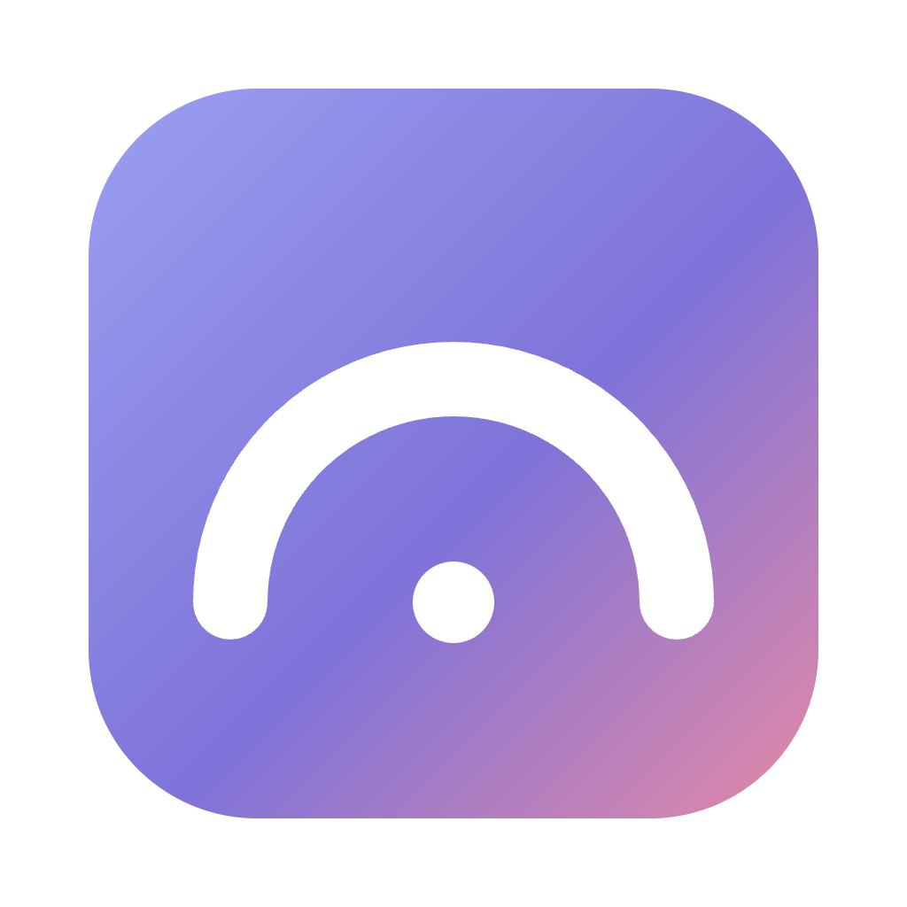
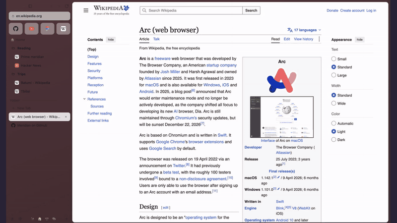

<h1 align="center">Meridian</h1>

<b>Arc is shutting down. Meridian keeps your Arc workflow, on real Chromium, with AI agents built in.</b>

  <a href="https://github.com/Undermove/meridian-browser/releases/latest/download/Meridian-mac-arm64.dmg"><b>Download for Mac</b></a> (Apple silicon)
  &nbsp;·&nbsp;
  <a href="https://github.com/Undermove/meridian-browser/releases/latest/download/Meridian-win.exe"><b>Download for Windows</b></a> (x64)
  &nbsp;·&nbsp;
  <a href="https://undermove.github.io/meridian-browser/">Website</a>

<b>Importing from Arc or Chrome: one click.</b> Spaces, pinned tabs, folders, favorites, bookmarks, open tabs, saved passwords and your logins. Arc stops working on December 22, 2026.

Meridian is a free, open-source browser built on Chromium, so sites, Google sign-in, passkeys and extensions work like in Chrome. On top of it: the Arc sidebar you know, and a home for coding agents (Claude Code, Codex and others) right next to the page they work on.

## The Arc workflow

- **Spaces** with their own colour, icon and **profile** (separate cookies and logins: work vs. personal). `⌃1…9` or `⌘⌥←/→` to switch.
- **⌘T command bar**: open tabs across all spaces, history, the archive, commands and the web in one list. Ask a question right there and the answer streams under it.
- **Pinned tabs and folders** that remember their home page, **Favorites**, and a **Today** list that archives itself after 12 hours. Everything archived stays searchable (`⌥⌘A`).
- **Split view** (`⌃⇧=`) with a draggable divider.
- **Peek**: links from pinned tabs open in an overlay; expand to a tab or a split.
- **Boosts**, as in Arc: a site your way (colour, dark mode, font, Zap to hide elements, your own CSS and JavaScript), or ask Claude to restyle it. Arc's boosts come over with the import.
- **Little window**: links from other apps open in a small window; "Open in Meridian" moves them in.
- **Air Traffic Control** (Settings › Links): send links from other apps to the right space by domain or pattern.
- **Import from Arc** in one click: spaces, colours, icons, pinned tabs, folders, favorites and Today, your **logins** (Arc's cookies, copied into the matching profiles; on macOS after you allow the keychain prompt), saved **passwords** and cards, history and boosts. Nothing leaves your computer and Arc isn't changed.
- **Import from Google Chrome** (File › Import from Chrome…): a space per Chrome profile, its bookmarks as pinned tabs and folders, the tabs you had open, sign-ins, passwords, history and extensions.
- Also: private windows, a theme editor per space, built-in ad and tracker blocking, Chrome extensions, a hideable sidebar on either side, every shortcut configurable.

## For AI agents

- **MCP server**: Claude Code, Claude Desktop, Codex or any MCP client can read and drive your browser with 28 tools (tabs, spaces, reading pages, clicks, typing, screenshots, split view, Boosts, translation). You choose the access level: off, read only, ask before acting, or full.
- **Workbench** (`⇧⌘E`): a browser tab with a file tree, the Monaco editor and real terminals. One-click launchers for Claude Code, Codex, Gemini CLI, Copilot, OpenCode and more. Put it in split view next to your `localhost`.
- **Context Insights**: each Claude Code tab shows how full its context is; one click explains where the tokens went (files read twice, a cold prompt cache, compactions) and shows your 5-hour and weekly limits.
- **Claude Code tabs come back**: after a restart or an update, the Workbench reopens your Claude Code sessions, in order, with their names and their permission mode.
- **Mission Control** (`⇧⌘M`): every agent at work, in every space: Claude Code and Codex sessions with their subagents, MCP clients, ⌘J chats. What each one is doing, how full its context is, and who waits for you. One click takes you to its terminal.
- **Secrets vault**: API keys encrypted with the system keychain, given to agents only as environment variables. Meridian asks before Claude Code reads a `.env` or a key file.
- **Sandboxed agents** with Docker or OrbStack: the agent sees only your project, as a non-root user, with the network off if you want.
- **Bring your own AI** for ⌘J, Tidy and link previews: a Claude API key, GitHub Copilot, or a free local model in Ollama or LM Studio. Meridian asks before anything goes to an AI on the internet.

## Install

| | |
|---|---|
| **macOS** (Apple silicon) | [Meridian-mac-arm64.dmg](https://github.com/Undermove/meridian-browser/releases/latest/download/Meridian-mac-arm64.dmg), or in Terminal: `curl -fsSL https://undermove.github.io/meridian-browser/install.sh \| bash` |
| **Windows 10 and 11** (x64) | [Meridian-win.exe](https://github.com/Undermove/meridian-browser/releases/latest/download/Meridian-win.exe) |

Linux and Intel Macs aren't supported by the current version.

**First launch.** The macOS build will be Apple-signed soon; until then, open it once, then **System Settings › Privacy & Security › Open Anyway**. On Windows, if SmartScreen says "Windows protected your PC", click **More info › Run anyway**. Every release has signed `SHA256SUMS.txt` to check the download.

**Updates** come by themselves: Meridian checks every hour, shows what's new, and restarts with your tabs.

## Connect Claude Code (MCP)

1. **Settings › AI**: pick an access level for agents.
2. Click **Connect** next to Claude Code or Codex. Meridian shows the exact command and runs it after you confirm.
3. Ask: *"Summarize the PRs in my open GitHub tabs"*, *"Find the Grafana dashboard I had open yesterday"*, *"Open three laptop reviews side by side"*.

Agents started in the Workbench get the browser tools for that session only; your global configs aren't touched.

## Security

Agents act inside your logged-in browser, so access is explicit:

| Level | What agents can do |
|---|---|
| **Off** (default) | Nothing. The control socket isn't even open. |
| **Read only** | List tabs and spaces, read pages, screenshots, history search. |
| **Ask before acting** | Everything, but every navigate / click / type / tab change waits for your OK. |
| **Full control** | Acts without asking, for agents you trust. |

- Running JavaScript in pages is a separate opt-in, off by default.
- MCP clients connect over a local socket (a named pipe on Windows) with a random name and token, new on every start; no TCP port, so websites can't reach it.
- Page text given to models is marked as untrusted content; models are told never to follow instructions found in pages.
- Mission Control gets only short, redacted summaries from agents (no prompts, no tool output).
- Keys are encrypted with the system keychain and never reach web pages.

Found a vulnerability? Please open a private security advisory on GitHub.

## Keyboard shortcuts

| | macOS | Windows |
|---|---|---|
| Command bar / edit URL | `⌘T` / `⌘L` | `Ctrl+T` / `Ctrl+L` |
| Reopen closed tab | `⇧⌘T` | `Ctrl+Shift+T` |
| Pin / unpin | `⌘D` | `Ctrl+D` |
| Toggle sidebar | `⌘S` | `Ctrl+S` |
| Ask AI | `⌘J` | `Ctrl+J` |
| Workbench / Mission Control | `⇧⌘E` / `⇧⌘M` | `Ctrl+Shift+E` / `Ctrl+Shift+M` |
| Split view / close | `⌃⇧=` / `⌃⇧-` | `Ctrl+Shift+=` / `Ctrl+Shift+-` |
| Spaces | `⌃1…9`, `⌘⌥←/→` | `Alt+1…9`, `Ctrl+Alt+←/→` |
| Little window / private window | `⌘⌥N` / `⇧⌘N` | `Ctrl+Alt+N` / `Ctrl+Shift+N` |
| Archive / downloads | `⌥⌘A` / `⇧⌘J` | `Ctrl+Alt+A` / `Ctrl+Shift+J` |
| Settings / all shortcuts | `⌘,` / `⌘/` | `Ctrl+,` / `Ctrl+/` |

## Known limitations

- On Windows, quit Arc before importing its logins (it locks its cookie files while open); Arc's extensions don't come over there yet. Google Chrome on Windows locks its logins to itself (App-Bound Encryption), so after importing from Chrome you sign in to your sites once more; its passwords do come over.
- No password manager or sync of its own yet.
- The Windows build has had less hands-on testing than macOS.

## Build from source

Meridian is a set of patches on Chromium plus its own UI. The code and build steps are on the [`chromium-port`](https://github.com/Undermove/meridian-browser/tree/chromium-port/chromium) branch (about 60 GB free space and a few hours for the first build). The `src/` folder on this branch is the earlier Electron version (0.4.x), kept for reference.

## Privacy

No account, no server, no telemetry. AI features talk only to the AI you connect. Details: [privacy page](https://undermove.github.io/meridian-browser/privacy.html).

## License

MIT. Third-party components: [THIRD_PARTY_NOTICES.md](THIRD_PARTY_NOTICES.md). Meridian is an independent project, not affiliated with or endorsed by The Browser Company. "Arc" is a trademark of its owner and is used here only to describe compatibility.
