<picture>
  <source media="(prefers-color-scheme: dark)" srcset="docs/readme/banner-dark.webp">
  <source media="(prefers-color-scheme: light)" srcset="docs/readme/banner-light.webp">
  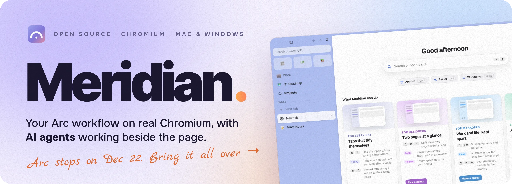
</picture>

  <a href="https://github.com/Undermove/meridian-browser/releases/latest/download/Meridian-mac-arm64.dmg">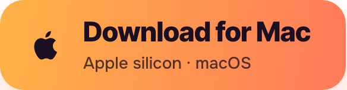</a>
  
  

  
  
  
  
  
  
  

  <a href="#move-in-from-arc-or-chrome">Move in</a> ·
  <a href="#the-arc-workflow">Arc workflow</a> ·
  <a href="#for-ai-agents">AI agents</a> ·
  <a href="#install">Install</a> ·
  <a href="#connect-claude-code-mcp">Connect Claude Code</a> ·
  <a href="#security">Security</a> ·
  <a href="#keyboard-shortcuts">Shortcuts</a> ·
  <a href="#known-limitations">Limitations</a>

**Meridian is a replacement for Arc first.** Arc stops working on December 22, 2026. If you just want the browser Arc was, that's what you get: the sidebar, Spaces and Boosts, with your whole setup brought over in one click. It's free, open source and built on Chromium, so sites, Google sign-in, passkeys and extensions work like in Chrome.

**AI agents are there if you want them.** If you work with coding agents (Claude Code, Codex and others), they get a home right next to the page they work on. If you don't, you can ignore that part and just browse.

<picture>
  <source media="(prefers-color-scheme: dark)" srcset="docs/readme/features-dark.webp">
  <source media="(prefers-color-scheme: light)" srcset="docs/readme/features-light.webp">
  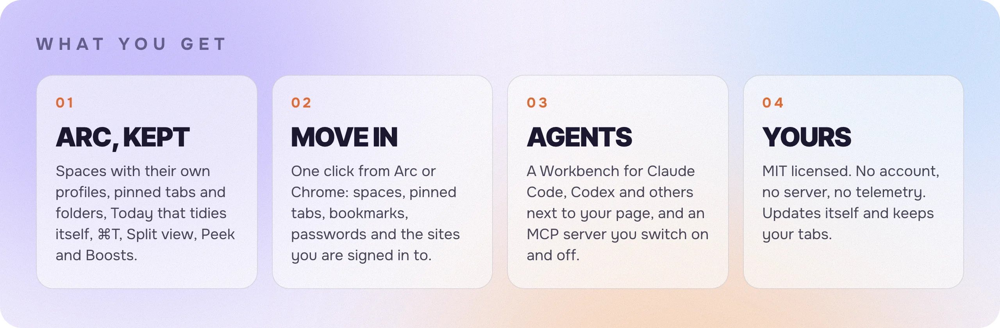
</picture>

## Move in from Arc or Chrome

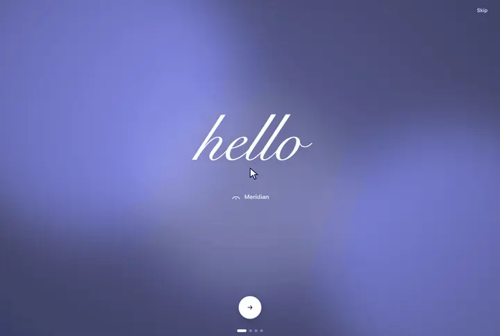

One click, on your computer. Nothing leaves it, and the other browser isn't changed.

| From | What comes over |
|---|---|
| **Arc** | Spaces with their colours and icons, pinned tabs, folders, Favorites and Today, your **logins** (Arc's cookies, copied into the matching profiles; on macOS after you allow the keychain prompt), saved **passwords** and cards, history and Boosts |
| **Google Chrome** | File › Import from Chrome…: a space per Chrome profile, its bookmarks as pinned tabs and folders, the tabs you had open, sign-ins, passwords, history and extensions |

## The Arc workflow

<table>
<tr>
<td width="50%">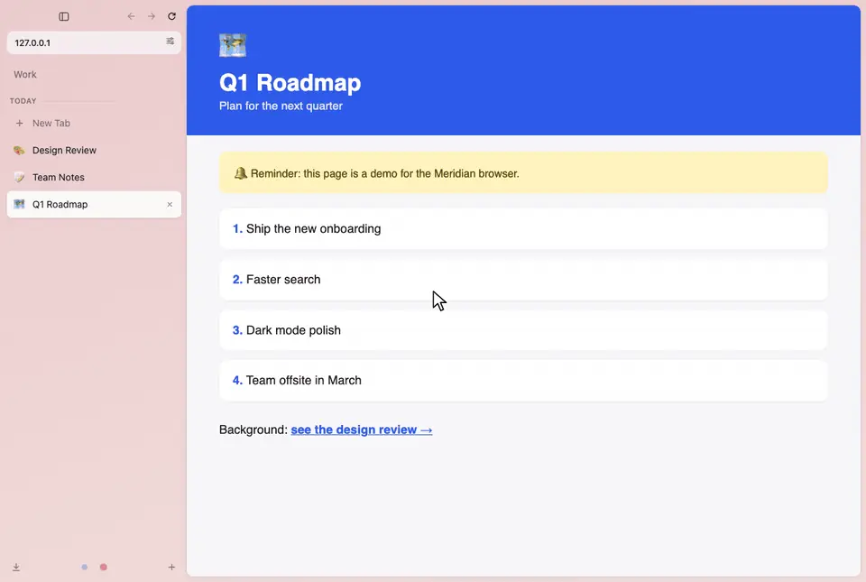 <b>Spaces</b> with their own colour, icon and <b>profile</b>: separate cookies and logins for work and personal. <code>⌃1…9</code> or <code>⌘⌥←/→</code> to switch.</td>
<td width="50%">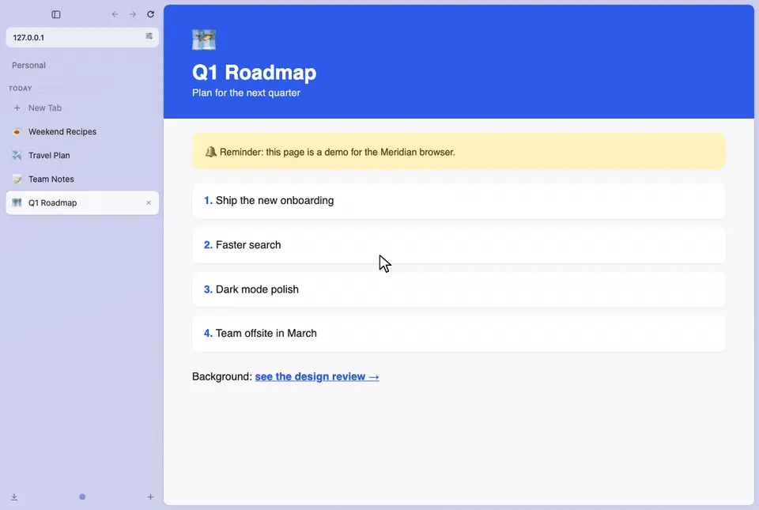 <b>⌘T command bar</b>: open tabs in every space, history, the archive, commands and the web in one list. Ask a question right there and the answer streams under it.</td>
</tr>
<tr>
<td>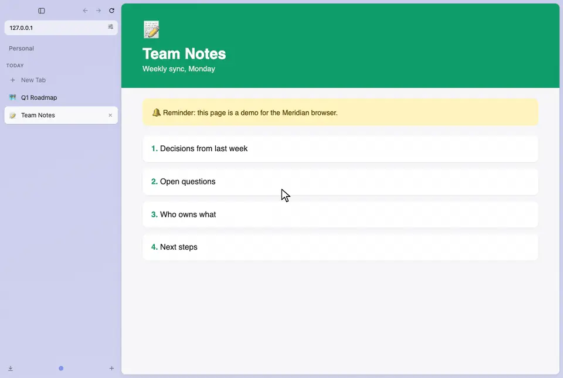 <b>Split view</b> (<code>⌃⇧=</code>) with a draggable divider.</td>
<td>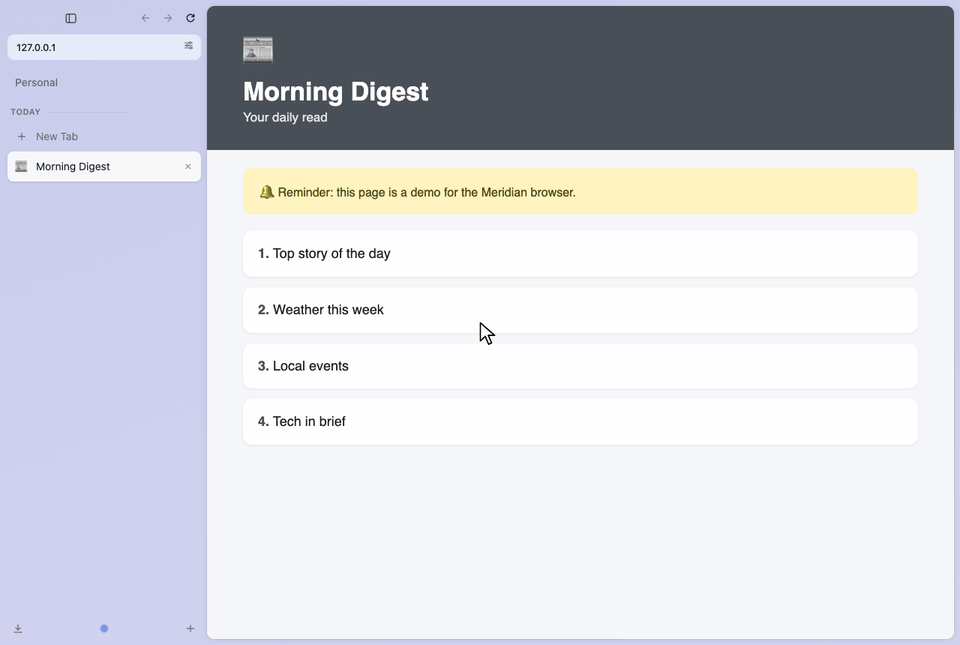 <b>Boosts</b>, as in Arc: a site your way (colour, dark mode, font, Zap to hide elements, your own CSS and JavaScript), or ask Claude to restyle it. Arc's boosts come over with the import.</td>
</tr>
</table>

- **Pinned tabs and folders** that remember their home page, **Favorites**, and a **Today** list that archives itself after 12 hours. Everything archived stays searchable (`⌥⌘A`).
- **Peek**: links from pinned tabs open in an overlay; expand to a tab or a split.
- **Little window**: links from other apps open in a small window; "Open in Meridian" moves them in.
- **Air Traffic Control** (Settings › Links): send links from other apps to the right space by domain or pattern.
- Also: private windows, a theme editor per space, built-in ad and tracker blocking, Chrome extensions, a hideable sidebar on either side, every shortcut configurable.

## For AI agents

Optional. Skip this section if you only came for the browser.

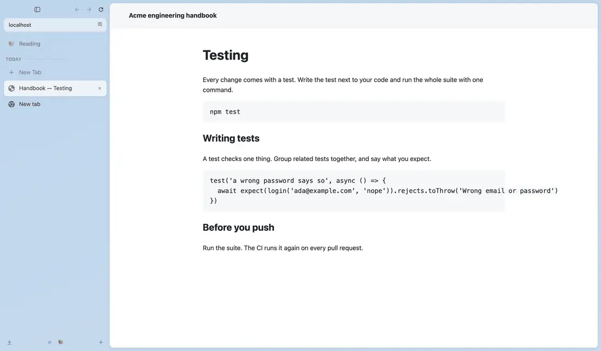

<table>
<tr>
<td width="50%">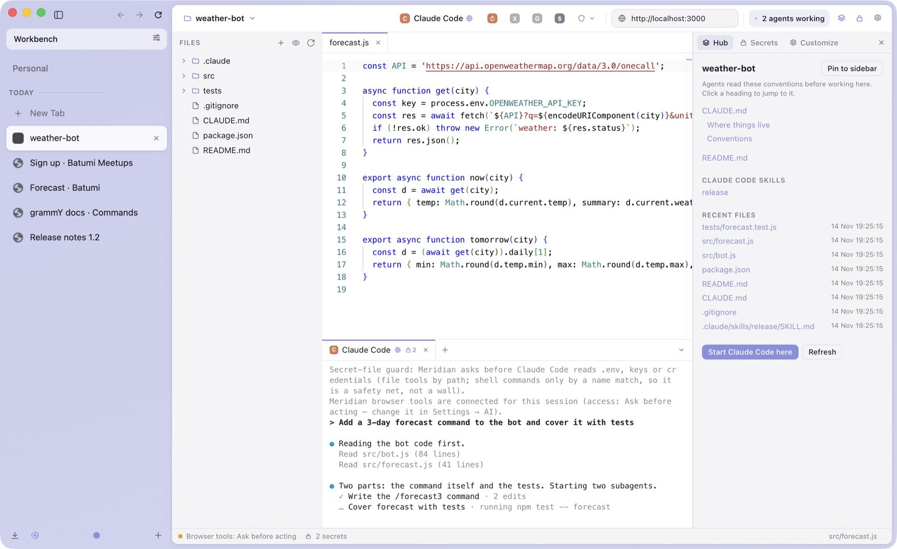 <b>Workbench</b> (<code>⇧⌘E</code>): a browser tab with a file tree, the Monaco editor and real terminals. One-click launchers for Claude Code, Codex, Gemini CLI, Copilot, OpenCode and more. Put it in split view next to your <code>localhost</code>.</td>
<td width="50%">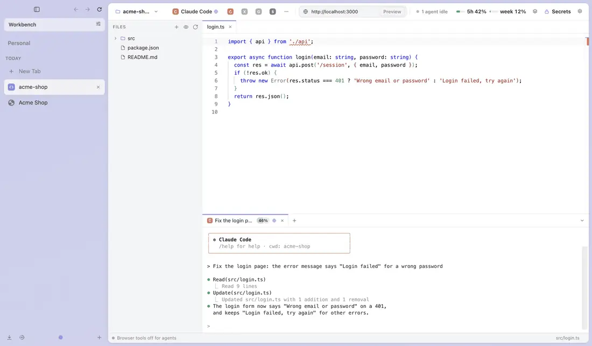 <b>Context Insights</b>: each Claude Code tab shows how full its context is; one click explains where the tokens went (files read twice, a cold prompt cache, compactions) and shows your 5-hour and weekly limits.</td>
</tr>
<tr>
<td>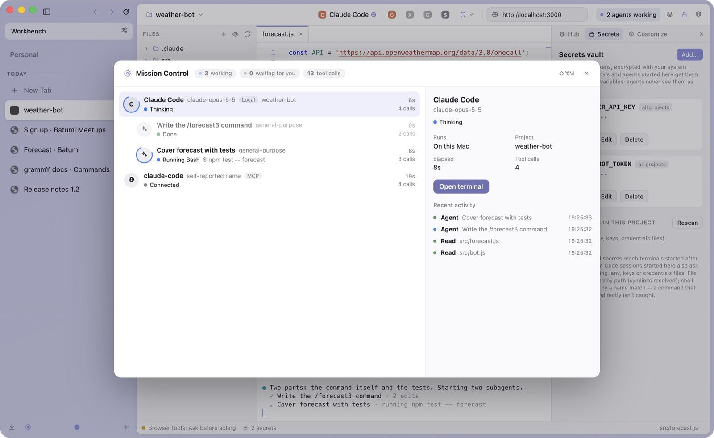 <b>Mission Control</b> (<code>⇧⌘M</code>): every agent at work, in every space: Claude Code and Codex sessions with their subagents, MCP clients, ⌘J chats. What each one is doing, how full its context is, and who waits for you.</td>
<td>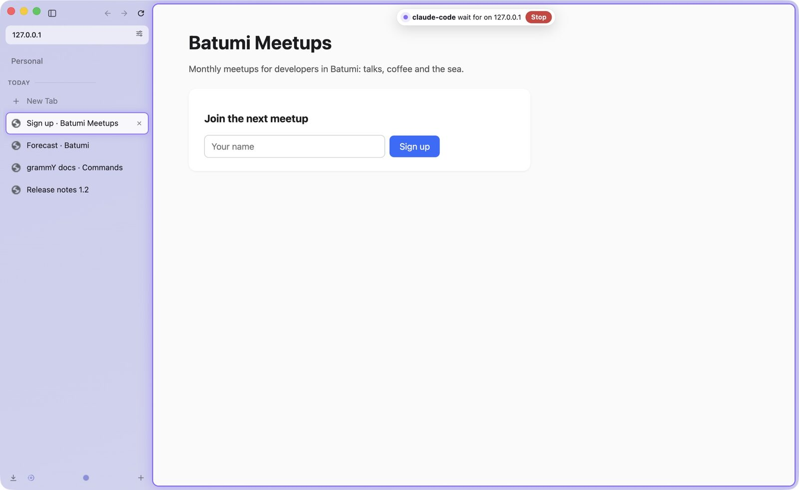 <b>MCP server</b>: Claude Code, Claude Desktop, Codex or any MCP client can read and drive your browser with 28 tools (tabs, spaces, reading pages, clicks, typing, screenshots, split view, Boosts, translation). You choose the access level, and the tab it works in shows it.</td>
</tr>
</table>

- **Claude Code tabs come back**: after a restart or an update, the Workbench reopens your Claude Code sessions, in order, with their names and their permission mode.
- **Secrets vault**: API keys encrypted with the system keychain, given to agents only as environment variables. Meridian asks before Claude Code reads a `.env` or a key file.
- **Sandboxed agents** with Docker or OrbStack: the agent sees only your project, as a non-root user, with the network off if you want.
- **Bring your own AI** for ⌘J, Tidy and link previews: a Claude API key, GitHub Copilot, or a free local model in Ollama or LM Studio. Meridian asks before anything goes to an AI on the internet.

## Install

| | |
|---|---|
| **macOS** (Apple silicon) | [Meridian-mac-arm64.dmg](https://github.com/Undermove/meridian-browser/releases/latest/download/Meridian-mac-arm64.dmg), or in Terminal: `curl -fsSL https://meridianbrowser.app/install.sh \| bash` |
| **Windows 10 and 11** (x64) | [Meridian-win.exe](https://github.com/Undermove/meridian-browser/releases/latest/download/Meridian-win.exe) |

Linux and Intel Macs aren't supported by the current version.

**First launch.** On Mac, Meridian is signed and notarized by Apple, so it opens like any other app. If macOS asks about **Meridian Safe Storage**, click **Always Allow**: that's where the key to your saved logins lives (Chrome and Arc ask the same). On Windows the installer isn't signed by Microsoft yet, so SmartScreen shows "Windows protected your PC": click **More info › Run anyway**. Every release has signed `SHA256SUMS.txt` to check the download.

**Updates** come by themselves: Meridian checks every 20 minutes, shows what's new, and restarts with your tabs.

## Connect Claude Code (MCP)

1. **Settings › AI**: pick an access level for agents.
2. Click **Connect** next to Claude Code or Codex. Meridian shows the exact command and runs it after you confirm.
3. Ask: *"Summarize the PRs in my open GitHub tabs"*, *"Find the Grafana dashboard I had open yesterday"*, *"Open three laptop reviews side by side"*.

Agents started in the Workbench get the browser tools for that session only; your global configs aren't touched.

## Security

Agents act inside your logged-in browser, so access is explicit:

| Level | What agents can do |
|---|---|
| **Off** (default) | Nothing. The control socket isn't even open. |
| **Read only** | List tabs and spaces, read pages, screenshots, history search. |
| **Ask before acting** | Everything, but every navigate / click / type / tab change waits for your OK. |
| **Full control** | Acts without asking, for agents you trust. |

- Running JavaScript in pages is a separate opt-in, off by default.
- MCP clients connect over a local socket (a named pipe on Windows) with a random name and token, new on every start; no TCP port, so websites can't reach it.
- Page text given to models is marked as untrusted content; models are told never to follow instructions found in pages.
- Mission Control gets only short, redacted summaries from agents (no prompts, no tool output).
- Keys are encrypted with the system keychain and never reach web pages.

Found a vulnerability? Please open a private security advisory on GitHub.

## Keyboard shortcuts

| | macOS | Windows |
|---|---|---|
| Command bar / edit URL | `⌘T` / `⌘L` | `Ctrl+T` / `Ctrl+L` |
| Reopen closed tab | `⇧⌘T` | `Ctrl+Shift+T` |
| Pin / unpin | `⌘D` | `Ctrl+D` |
| Toggle sidebar | `⌘S` | `Ctrl+S` |
| Ask AI | `⌘J` | `Ctrl+J` |
| Workbench / Mission Control | `⇧⌘E` / `⇧⌘M` | `Ctrl+Shift+E` / `Ctrl+Shift+M` |
| Split view / close | `⌃⇧=` / `⌃⇧-` | `Ctrl+Shift+=` / `Ctrl+Shift+-` |
| Spaces | `⌃1…9`, `⌘⌥←/→` | `Alt+1…9`, `Ctrl+Alt+←/→` |
| Little window / private window | `⌘⌥N` / `⇧⌘N` | `Ctrl+Alt+N` / `Ctrl+Shift+N` |
| Archive / downloads | `⌥⌘A` / `⇧⌘J` | `Ctrl+Alt+A` / `Ctrl+Shift+J` |
| Settings / all shortcuts | `⌘,` / `⌘/` | `Ctrl+,` / `Ctrl+/` |

## Known limitations

What doesn't work yet

- On Windows, quit Arc before importing its logins (it locks its cookie files while open); Arc's extensions don't come over there yet. Google Chrome on Windows locks its logins to itself (App-Bound Encryption), so after importing from Chrome you sign in to your sites once more; its passwords do come over.
- No password manager or sync of its own yet.
- The Windows build has had less hands-on testing than macOS.

## Build from source

Meridian is a set of patches on Chromium plus its own UI. The code and build steps are in [`chromium/`](chromium/) (about 60 GB free space and a few hours for the first build). The `src/` folder and the root `package.json` are the earlier Electron version (0.4.x), kept for reference.

## Privacy

No account, no server, no telemetry. AI features talk only to the AI you connect. Details: [privacy page](https://meridianbrowser.app/privacy.html).

## License

MIT. Third-party components: [THIRD_PARTY_NOTICES.md](THIRD_PARTY_NOTICES.md). Meridian is an independent project, not affiliated with or endorsed by The Browser Company. "Arc" is a trademark of its owner and is used here only to describe compatibility.

