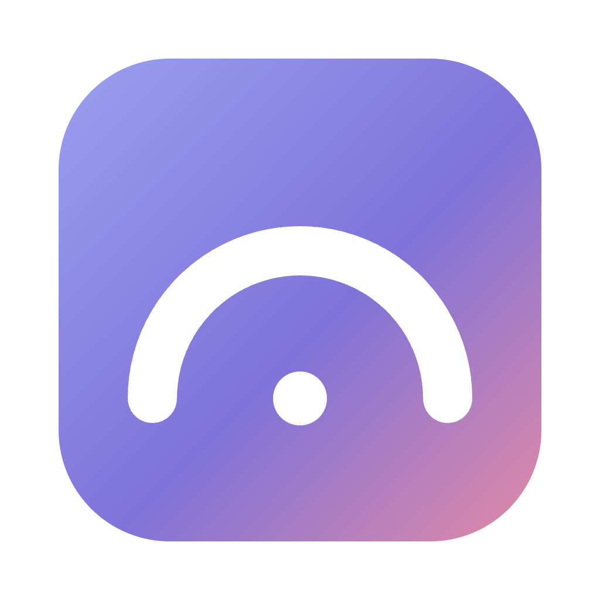

<p align="center"></p>

<h1 align="center">Meridian</h1>
<p align="center"><b>The open-source Arc browser alternative for macOS, Windows and Linux, built for AI agents.</b></p>

Arc is being sunset. Meridian keeps the Arc workflow you're used to (spaces, pinned tabs, a Today list that tidies itself, split view, Peek, the command bar) and imports your Arc sidebar in one click. It's also built around AI from the start: a built-in Claude assistant, and an **MCP server** so Claude Code, Claude Desktop or any MCP client can read and drive your browser, with access you control.

## Features

**The Arc workflow**
- **Spaces** with their own colour, icon and **profile** (separate cookies and logins: work vs. personal). Switch with `Ctrl+1…9` on macOS, `Alt+1…9` on Windows/Linux, or `⌘⌥←/→`.
- **Pinned tabs and folders** that remember their home URL. Navigate away and a `/` button takes you back.
- **Favorites** grid at the top, shared across spaces of the same profile.
- **Today**: unpinned tabs auto-archive after 12 h (configurable). Everything archived stays searchable.
- **Command bar** (`⌘T` / `⌘L`): search open tabs across spaces, history, the archive, commands, or the web.
- **Split view** (`Ctrl+Shift+=`) with a draggable divider.
- **Peek**: links from pinned tabs to other sites open in an overlay. Expand to a tab or a split.
- **Little window**: links from other apps open in a small window. "Open in Meridian" moves them in.
- **Air Traffic Control** (Settings → Links): route links from other apps by domain or URL pattern to a chosen space, or to the Little window.
- **Private windows** (`⇧⌘N`): an in-memory profile; no history, cookies or site data survive closing the window.
- **Archive** view (`⌥⌘A`) to browse, search and restore archived tabs; a downloads popover; a space theme editor with gradients and icons.
- Hide the sidebar (`⌘S`) and reveal it by hovering the window edge. Sidebar can sit on the right.
- Drag and drop tabs between favorites, pinned, folders and Today.
- **Import from Arc**: spaces, colours, icons, pinned tabs, folders, favorites and Today tabs, read locally from Arc's sidebar file on macOS and Windows.

**AI-centric**
- **Bring your own AI, no API key needed**: Meridian uses the AI you already pay for, running on your computer: **Claude Code, Codex, Gemini CLI, GitHub Copilot, Cursor, OpenCode, Qwen Code, Amp, Goose, Droid**, or local models through **Ollama** / **LM Studio**. Settings → AI (and the welcome tour) shows what's installed and signed in, and installs or signs in with one click (the exact command runs in your terminal after you confirm). Agents answer as text only here: no tools, no MCP, no user plugins, the prompt on stdin, in a private empty folder.
- **Ask from the command bar** (`⌘T`): type a question and the answer streams right under it. It knows Meridian itself ("how do I split the screen?"). **Continue in chat** carries the conversation to `⌘J`.
- **Modes**: Everyday, AI for work (designers, managers, writers) and Developer. The welcome tour asks; the developer tools stay out of sight until you want them.
- **Ask panel** (`⌘J`): summarize, ask about the current page. With a Claude API key it can also act in the browser (open tabs, read pages, click, type).
- **MCP server** with 21 browser tools: `list_spaces`, `list_tabs`, `search_tabs`, `search_history`, `read_page`, `get_interactive_elements`, `screenshot`, `open_tab`, `navigate`, `history_nav`, `activate_tab`, `close_tab`, `click`, `type_text`, `press_key`, `scroll`, `wait_for`, `organize_tab`, `split_view`, `create_space`, and opt-in `run_javascript`.
- Tabs an agent is working in glow. An activity bar shows what it did and has a **Stop** button.
- **Mission Control** (`⇧⌘M`): a live tree of every agent working with Meridian: Claude Code and Codex sessions started from the Workbench (locally or in a Docker sandbox) with their subagents and nested subagents, MCP clients driving the browser, and ⌘J chats. Status (thinking / running a tool / waiting for you / done), the current tool with a redacted summary, elapsed time, tool calls, project. Click to jump to the agent's terminal or tab. A notification and a sidebar badge when an agent waits for you; "N agents working" in the sidebar and the Workbench.
- **Tidy Today**: Claude proposes folders and shorter titles for your Today tabs; you review a diff and apply what you want. **Ask Claude** straight from the command bar. **Link previews**: hold `⇧` over a link for a short summary of the page (opt-in, Settings → AI).

**Workbench: a mini IDE for working with coding agents** (`⇧⌘E`)
- A tab with a file tree, a Monaco editor (the VS Code editor) and real terminals. One-click launchers for **Claude Code**, **Codex**, **Gemini CLI** or a shell in your project. Put it in split view next to your `localhost` preview.
- Agents started here get Meridian's browser tools for that session only, so they can open your app, read it and take screenshots. Your global CLI configs aren't touched.
- **Make it yours with agents**: the Workbench loads `user.css`, `settings.json` and plugins from its own folder and reloads them live. Click **Customize with Claude** and ask for a bigger font, a deploy button or a new panel. New plugins run only after you approve them. Every change is snapshotted, and Safe Mode starts without customizations.
- **Secrets vault**: API keys encrypted with your system keychain, global or per project. Agents only see them as environment variables of the processes Meridian starts, never as text. Meridian warns you when you paste a key into a terminal or into ⌘J, offers to move `.env` files into the vault, and asks before a Claude Code session reads a secret file.
- **Sandboxed agents** with Docker or OrbStack: run Claude Code, Codex or a shell in a container that sees only your project. The agent runs as a non-root user with no capabilities. `.git`, `.claude` and other auto-run config are read-only, so the agent can't plant hooks. It gets only the secrets you pick for the session (passed in a file, not visible in `docker inspect`), and you can switch the network off.
- **Hubs**: set up a personal folder for posts, notes or code that you work on with agents. You get a structure, `AGENTS.md`/`CLAUDE.md` conventions, git and a starter skill, pinned in your sidebar in one click.

**Also**
- Built-in ad and tracker blocking (Ghostery engine), per-site permission prompts, downloads, find in page, zoom, reopen closed tab, session restore.
- Chromium engine: sites work like in Chrome. Experimental unpacked Chrome extension loading.

## Install

**Easiest: [undermove.github.io/meridian-browser](https://undermove.github.io/meridian-browser/)** picks the right download for your computer. On macOS and Linux you can also install or update with one line:

```bash
curl -fsSL https://undermove.github.io/meridian-browser/install.sh | bash
```

Or grab a build from **[Releases](https://github.com/Undermove/meridian-browser/releases/latest)**:

| | Download |
|---|---|
| **macOS** | `Meridian-…-mac-arm64.dmg` (Apple silicon) or `…-mac-x64.dmg` (Intel) |
| **Windows** | `Meridian-…-win….exe` (one installer for x64 and ARM) |
| **Linux** | `Meridian-…-linux-….AppImage`, or the `.deb` for Debian/Ubuntu (x64 and arm64) |

Meridian isn't signed with paid Apple/Microsoft certificates yet, so the first launch needs one extra step:

- **macOS**: open the `.dmg`, drag Meridian to Applications, then run once in Terminal:
  `xattr -dr com.apple.quarantine /Applications/Meridian.app`
  (or try to open it, then System Settings → Privacy & Security → **Open Anyway**).
- **Windows**: if SmartScreen says "Windows protected your PC", click **More info → Run anyway**.
- **Linux**: `chmod +x Meridian-*.AppImage && ./Meridian-*.AppImage`, or `sudo apt install ./Meridian-*.deb`.

`SHA256SUMS.txt` in every release lets you verify the download.

### Build from source

```bash
git clone https://github.com/Undermove/meridian-browser && cd meridian-browser
npm install
npm start            # run from source
npm run dist:mac     # or dist:win / dist:linux → installers in dist/
```

Releases are built by GitHub Actions from a `v*` tag (`.github/workflows/build.yml`).

## Connect Claude Code (MCP)

1. In Meridian open **Settings → AI** (or the welcome tour) and pick an agent access level.
2. Click **Connect** next to Claude Code or Codex: Meridian shows the exact command and runs it after you confirm. Or run it yourself, e.g.

   ```bash
   claude mcp add -s user meridian -- node /path/to/meridian-browser/mcp/meridian-mcp.js
   ```

   For Claude Desktop, add the same `command` / `args` to `claude_desktop_config.json`.
3. Ask: *"Read my open GitHub tabs and summarize the PRs"*, *"Find the Grafana dashboard I had open yesterday"*, *"Open three tabs comparing these laptops and put them in split view"*.

## Security model

Agents act inside your logged-in browser, so access is explicit and layered:

| Level | What agents can do |
|---|---|
| **Off** (default) | Nothing. The control socket isn't even open. |
| **Read only** | List tabs and spaces, read pages, screenshots, history search. |
| **Ask before acting** | Everything else too, but every navigate / click / type / tab change needs your confirmation in a native dialog. |
| **Full control** | Acts without asking. Meant for agents you trust. |

- Running JavaScript in pages is a **separate opt-in**, off by default. In "ask" mode the dialog shows the full code (code too long to review is refused), and `type_text` shows the full text, including whether it will submit.
- Click confirmations show the element's visible text next to its page-supplied label, its link and its form target. After you approve, the element is checked again so it can't move or be covered while the dialog is open. Dialogs default to **Deny**.
- The assistant's preset buttons (Summarize, …) never get browser tools, and "use browser" is off until you turn it on for a chat.
- MCP clients connect over a **unix socket** (named pipe on Windows) with a random name and a random **bearer token**, both new on every start, advertised only after the socket is bound, in a `chmod 600` file. The bridge checks that the socket is owned by the current user. There's no TCP port, so websites can't reach it, and requests carrying an `Origin` header are rejected.
- Page text given to models is wrapped as **untrusted content**, with any attempt to close the wrapper tags neutralized, and is read in an isolated world so pages can't fake it. Models are told never to follow instructions found in pages.
- Agent page scripts run in an **isolated JS world**, so pages can't tamper with them. Agents can only open `http(s)` URLs.
- **Mission Control** gets agent events over a private local channel: a unix socket in a `0700` temp dir (a random named pipe on Windows), a per-session random token in the agent's environment, size- and rate-limited JSON lines, nothing sent back. Claude Code hooks are added to the session's own `--settings` file as async hooks (they never block the agent) next to the secret guard; Codex gets a per-session `notify` override. Hooks send only short summaries (file names, command heads, hosts), which Meridian redacts again (tokens, `KEY=value`, URL credentials, vault values). Prompts, tool inputs and outputs are never sent; the persisted history holds only labels, times and counts.
- The Claude API key is **encrypted with the OS keychain** (safeStorage) and only used in the main process. Web content and the UI page never see it.
- Electron hardening: sandboxed UI renderer with context isolation, `<webview>` preferences forced safe in `will-attach-webview`, IPC sender validation, page-initiated navigation to `file:` or other privileged schemes blocked, server redirects to such schemes blocked, external app links (`mailto:`, `zoommtg:` …) allowlisted and confirmed every time, executable and HTML downloads and download bursts need confirmation, WebUSB/HID/Serial and Bluetooth pickers denied, client certificates chosen by you, camera and mic as separate per-site prompts (resettable in Settings), favicons fetched through the site's profile and shown as `data:` URLs, dev/test hooks disabled in packaged builds, and Electron fuses (no `RunAsNode`, no `NODE_OPTIONS`, no inspector flags, ASAR integrity, cookie encryption, no extra `file://` privileges).

Found a vulnerability? Please open a private security advisory on GitHub.

## Keyboard shortcuts

| | macOS | Windows / Linux |
|---|---|---|
| New tab / command bar | `⌘T` | `Ctrl+T` |
| Edit URL | `⌘L` | `Ctrl+L` |
| Close tab | `⌘W` | `Ctrl+W` |
| Reopen closed tab | `⇧⌘T` | `Ctrl+Shift+T` |
| Pin / unpin | `⌘D` | `Ctrl+D` |
| Toggle sidebar | `⌘S` | `Ctrl+S` |
| Ask Claude | `⌘J` | `Ctrl+J` |
| Mission Control | `⇧⌘M` | `Ctrl+Shift+M` |
| Split view / close | `⌃⇧=` / `⌃⇧-` | `Ctrl+Shift+=` / `Ctrl+Shift+-` |
| Spaces | `⌃1…9`, `⌘⌥←/→` | `Alt+1…9`, `Ctrl+Alt+←/→` |
| Tabs | `⌘1…9`, `⌃Tab` | `Ctrl+1…9`, `Ctrl+Tab` |
| Copy URL | `⇧⌘C` | `Ctrl+Shift+C` |
| New folder | `⌥⇧⌘N` | `Ctrl+Alt+Shift+N` |
| Little window | `⌘⌥N` | `Ctrl+Alt+N` |
| Private window | `⇧⌘N` | `Ctrl+Shift+N` |
| Archive / Downloads | `⌥⌘A` / `⇧⌘J` | `Ctrl+Alt+A` / `Ctrl+Shift+J` |
| Settings / all shortcuts | `⌘,` / `⌘/` | `Ctrl+,` / `Ctrl+/` |

Every shortcut can be changed in **Settings → Shortcuts**.

## Known limitations

- Logins don't transfer from Arc (cookies are encrypted with Arc's keychain key). Sign in once per profile.
- No built-in password manager or sync yet. Use your password manager's desktop app.
- Chrome extensions are experimental: background and content scripts load, but toolbar popups don't yet.
- No Boosts, Easels or Notes.
- Codex has no per-tool hooks, so the secret-file guard and Mission Control's tool view only cover Claude Code. For Codex sessions Meridian falls back to scanning the project for secret files.
- Inside a Docker sandbox git is read-only, by design. Commit from a host terminal.
- Windows and Linux builds are produced by CI but have had far less hands-on testing than macOS.

## Roadmap

Extension toolbar, a password manager integration, sync between devices, Boosts-style site tweaks.

## License

MIT. Meridian is an independent project, not affiliated with or endorsed by The Browser Company. "Arc" is a trademark of its respective owner and is used here only to describe compatibility.
